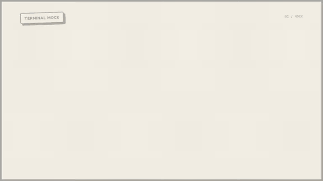
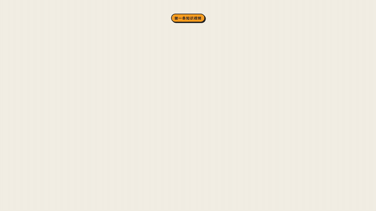
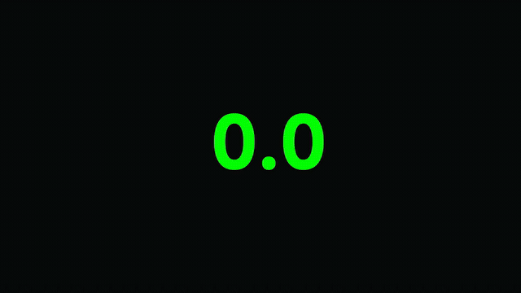
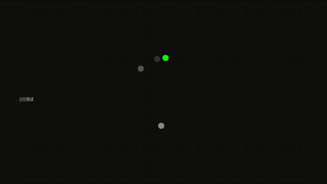
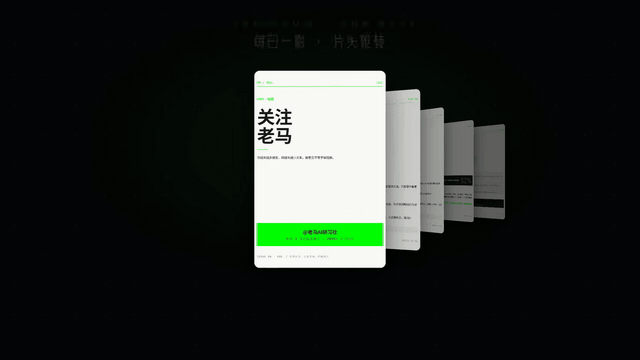

# Motion Prompts · 视频动效提示词（389 个免费开源，陆续开放至 512）

> 上图：编辑器试玩器（测试区）——挑底片、叠动效、拖位置、画轨迹，compose.json 一键导入/导出，浏览器里完成编排。

挑一个提示词，粘贴给任意 AI（Claude Code / Codex / 豆包 / DeepSeek……），
AI 会输出一个自包含的动效 HTML 页面——浏览器打开即播放，录屏进剪辑软件直接用。

**不需要 Claude 和 Codex。豆包、DeepSeek 也能一键出片。**

**🎬 在线预览全部动效 → https://maning789link.top/station.html**

## 快速开始

1. 先去[预览站](https://maning789link.top/station.html)看动效长什么样；
2. 从 [SAMPLES.md](SAMPLES.md) 挑一个，复制 `.md` 文件里分隔线以下的整段提示词；
3. 粘贴发给你的 AI，不需要任何额外解释；
4. AI 输出 HTML 存成文件，浏览器打开播放，录屏即成片。

生成的页面是 1920×1080 横屏，文案、数字、颜色都集中在文件顶部的 JS 常量里，随改随用。

## 效果预览

GIF 有压缩，预览站里是 1080p 原片：

| 终端打字演示（奶油版） | 前后数据对比（奶油版） |
|:---:|:---:|
|  |  |
| **大数字卡** | **环形占比图** |
|  |  |
| **封面流转播** | **档案照片放大聚焦** |
|  |  |

## 配套 Skill：没有它，这几百个提示词只是素材

单独复制一个提示词，你能得到一个动效——这很好，但**这只是零件**。
真正做内容的人缺的不是零件，是**流水线**：

- 写完一篇文章，还要人肉拆点、逐个选模板、逐条改文案、逐个录屏、进剪辑软件拼接——
  一条 60 秒的片子，动效能吃掉一下午；
- 想保持风格统一？每个镜头的配色、字体、节奏都得人肉对齐；
- 画面和口播对轨，又是一场手工拉锯。

**装上配套生产 Skill，这一切交给 AI**：把文章丢给它，它自动
**拆文案 → 选模板 → 渲单镜 → 合成底片 → 输出 compose.json**——交付物永远是两个文件：
`base.mp4`（底片）+ `compose.json`（动效编排清单）。之后三种加工方式任选：

1. **自合成**：本地按 compose.json 逐层渲染出片；
2. **测试区自助**：把两个文件传上[编辑器试玩器](https://maning789link.top/station.html)——
   拖位置、调大小、画轨迹、播预览，调完导出新 JSON 再合成。Agent 改十遍不如这里拖一遍，省 token；
3. **平台代加工**：文件交给老马团队出片（会员权益）。

compose.json 是**开放规范**（compose/1）——把同一份 JSON 递回给你自己的 Agent，
照着规范就能做出你自己的 Skill，往后自我更新，不用依赖任何人。

## 更新路线图（每周五更新一批，陆续开放至 512 个）

当前 379 个已全部免费开源。接下来新增四个风格族，**每周五放出一批（约 10 个），放完合计 512 个**：

| 新模板族 | 数量 | 风格 / 适合内容 |
|---|---|---|
| 积木风（brik） | 34 | 有棱有角的积木拼搭语言：企业宣传、电商带货、短视频开场钩子 |
| 夜城风（night） | 72 | 夜景霓虹质感：封面、图表、转场 |
| 音乐系（mus） | 10 | 频谱点阵、五线谱流动 |
| 片尾系（outro） | 17 | 品牌落款、行动引导 |

以上 133 个做完一批放一批，全程免费开源；教学拆解类内容在知识星球，不在本仓。

最新更新：389 个提示词免费开源（标准版 88 + 奶油贴纸版 90 + 视觉动效/纪实档案/转场包等 201 + 积木风 10），会员版 64 个不开源（2026-09）；2026-10 起按上表周更至 512（批次 1 已放出：积木风 10 个，编号 380–389）。

## 本地渲染（可选）

提示词生成的 HTML 用浏览器录屏就能用；要直接出 MP4，可用 hyperframes 渲染器。
我们备好了**免 npm 的离线环境包**（内置浏览器，解压即用，全程不联网），
领取方式见预览站首页说明。

## 本仓有什么

- `prompts/` —— **389 个提示词已免费开源，陆续开放至 512 个**（会员版 64 个新风格族模板不在开源范围）：
  - 标准版 88 个：数据可视化、知识讲解、产品演示、标题开场、流程图、信息卡片，暗色科技风；
  - 奶油贴纸版 90 个：同一批场景的浅色奶油风版本，气质更软，适合生活方式、情感、轻知识内容；
  - 2026-09 新增 201 个：纪实档案族、转场包、视觉动效（shot/sc2 系列）等，全部转免费开源；
  - 会员版 64 个（玻璃拟态/公文表单/白板黄卡/档案拼贴/3D Hero/模式特效/教学外壳/书页系）不在开源范围。
  全部开箱即用。
- `SAMPLES.md` —— 总目录（编号 / 名称 / 分类 / 时长）
- `assets/` —— 效果预览 GIF 与二维码

本仓持续周更。

## 许可（摘要，以 LICENSE 全文为准）

- ✅ 提示词可自由使用，**生成的视频可商用**（接单、广告、发平台都行）；
- ❌ 禁止将提示词本身打包转售，或搬运到其他提示词站/付费社群再分发；
- ❌ 禁止删除文件中的溯源标识、禁止冒用「老马AI研习社」名义；
- ℹ️ 模板依赖的字体（MiSans / 美呗嘿嘿体）、GSAP、hyperframes 均为第三方组件，
  受各自许可约束，字体文件不随本仓分发。

觉得有用就 Star 一下，预览站会持续上新。
