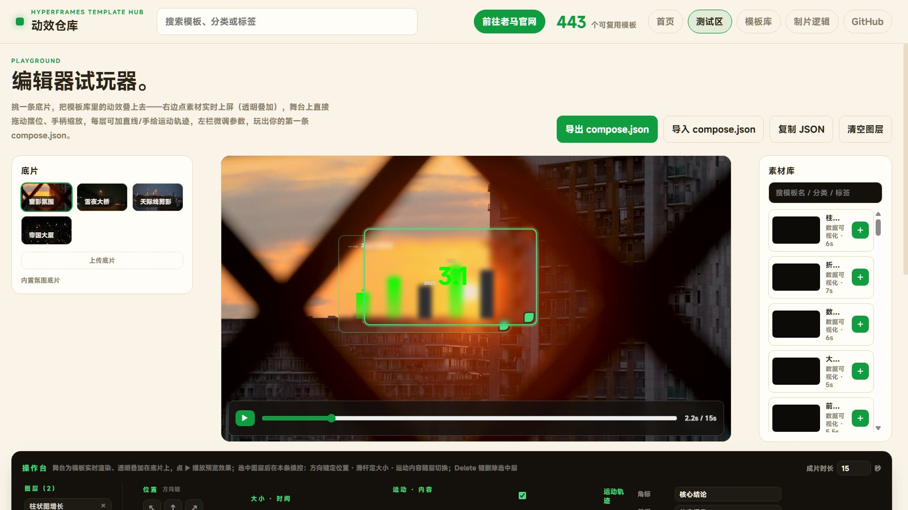
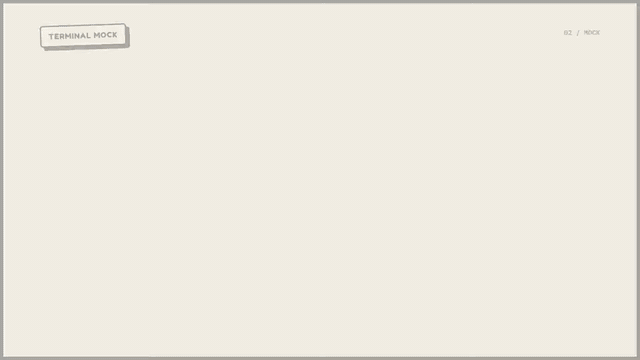
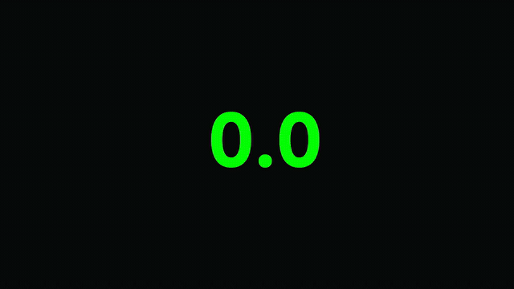
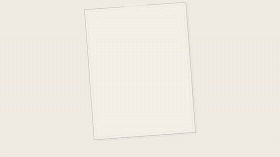
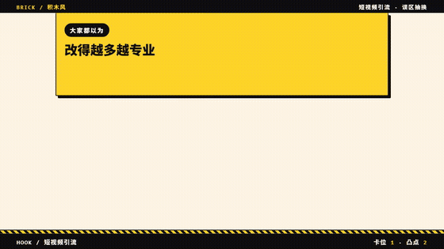

# Motion Prompts · 视频动效提示词（600 个 · 免费获取）

License: 见 [LICENSE](./LICENSE) — 自定义许可，非 OSI 标准。

[](https://maning789link.top/station.html)
[](https://maning789link.top/lab/)
[](#本仓有什么)
[](LICENSE)

[](https://maning789link.top/station.html)

> 上图：编辑器试玩器（测试区）——挑底片、叠动效、拖位置、画轨迹，compose.json 一键导入/导出，浏览器里完成编排。

**🎬 在线预览全部动效 → https://maning789link.top/station.html**

**🧪 动效测试站（443 个模板：改文案 / 改颜色 / 换底图 / 摆位置，即时试玩）→ https://maning789link.top/lab/**

## 本仓给什么

- **600 个提示词** —— 全量免费获取，直接可用：复制一段喂给任意 AI，AI 照样给你生成一个动效页面；
- **10 条样例模板** —— 可运行 HTML，浏览器打开即播放，看看「提示词生成出来的东西长什么样」；
- **效果预览** —— README 里直接看 GIF。

完整素材库（**1047 个可运行模板 + 97 个可嵌入组件**）已于 2026-11-26 **全部在预览站公开上线、可免费试玩**；本仓只保留提示词与样例模板，配套生产 Skill 需联系作者获取，见[「想要完整内容？」](#想要完整内容)。

> 模板为什么不随本仓分发？本仓要轻、clone 要快，而模板有 1000+ 条且需持续维护，
> 所以模板放在预览站（1047 条全部公开可试玩），本仓只保留 600 个提示词与 10 条样例模板。

> [!IMPORTANT]
> **给已经 clone 过旧版本的同学**
>
> 本仓历史做过**两次改写**：
> 1. 清理了误随仓分发的账号二维码文件（含个人隐私信息）；
> 2. 2026-11-25 起**撤出全部模板与组件文件**，只保留 600 个提示词与 10 条样例模板。
>
> 改写只对本仓库生效，**`git pull` 不会更新历史**，你本地那份旧 clone 里的旧文件仍在。
> 请删掉旧目录，重新 clone：
>
> ```bash
> git clone https://github.com/maning636/motion-prompts.git
> ```
>
> **给 fork 的维护者**
>
> 目前有两个 fork 仍停在改写前的历史（`linhaosunny/motion-prompts`、`okeyba/motion-prompts`），
> 其中的二维码文件与模板文件只有各自仓库的所有者能清理，fork 侧需要各自处理：
> 删掉旧 clone 重新 clone 再推，或联系仓库所有者协助。本次撤出模板与组件后，
> fork 侧同样需要重新处理一次。

## 快速开始

**方式一（主推）：用提示词让 AI 生成**

1. 从 [SAMPLES.md](SAMPLES.md) 挑一个提示词；
2. 复制 `.md` 文件里分隔线以下的整段提示词；
3. 粘贴发给你的 AI（Claude Code / Codex / 豆包 / DeepSeek……），不需要任何额外解释；
4. AI 输出 HTML 存成文件，浏览器打开播放，录屏即成片。

**方式二：直接看仓里那 10 条样例模板**

浏览器打开 `templates/<模板名>/index.html`，打开即播放；文案、数字、颜色都集中在文件顶部的 JS 常量里。

生成的页面是 1920×1080 横屏，文案、数字、颜色都集中在文件顶部的 JS 常量里。

**不需要 Claude 和 Codex。豆包、DeepSeek 也能一键出片。**

## 样例模板（10 条）

完整素材库（1047 个模板 + 97 个组件）不再随本仓分发；**全部 1047 条已在预览站公开上线，可免费试玩**。
下面 10 条是可以直接打开就跑的样例，覆盖 9 个技术分类，用来直观看到「提示词生成出来的东西长什么样」。

| # | 名称 | 分类 | 文件 |
|---|---|---|---|
| 1 | 同比三段递进 | 信息卡片 | [`templates/brik-dq-05/index.html`](templates/brik-dq-05/index.html) |
| 2 | 章节跳转表（透明叠加） | 叠加组件 | [`templates/aud-progress-02/index.html`](templates/aud-progress-02/index.html) |
| 3 | 宇宙星云·黑洞吸积 | 可嵌入素材 | [`templates/stk-cosmic-01/index.html`](templates/stk-cosmic-01/index.html) |
| 4 | 叠压卡片 · 出门干活带这几样就够 | 图解与流程 | [`templates/blk-stack-gear-kit/index.html`](templates/blk-stack-gear-kit/index.html) |
| 5 | API 调用 | 封面与卡片 | [`templates/api-call-mock/index.html`](templates/api-call-mock/index.html) |
| 6 | 面积图 | 数据与图表 | [`templates/area-chart/index.html`](templates/area-chart/index.html) |
| 7 | 中线均衡条 | 数据可视化 | [`templates/aud-eq-01/index.html`](templates/aud-eq-01/index.html) |
| 8 | 标题换词 | 文字与收尾 | [`templates/blk-brut-kb-08/index.html`](templates/blk-brut-kb-08/index.html) |
| 9 | 滑动变焦·字隧道 | 镜头与转场 | [`templates/atom-kinetic-01/index.html`](templates/atom-kinetic-01/index.html) |
| 10 | 终端 Mock（奶油贴纸） | 封面与卡片 | [`templates/cream-terminal-mock/index.html`](templates/cream-terminal-mock/index.html) |

> 这 10 条只是样例。全部 1047 条模板与 97 个 480×270 组件均已公开上线可试玩，配套生产 Skill 需联系作者获取，
> 见[「想要完整内容？」](#想要完整内容)。

## 效果预览

GIF 有压缩，预览站里是 1080p 原片：

| 终端打字演示（奶油版） | 前后数据对比（奶油版） |
|:---:|:---:|
|  |  |
| **大数字卡** | **环形占比图** |
|  |  |
| **封面流转播** | **档案照片放大聚焦** |
|  |  |

> 以上 GIF 仅作**效果展示**；完整模板见预览站（1047 条全部公开可免费试玩）。

### 精选样片

七大类各挑代表，共 42 条 GIF，按形态分层挑选（积木风 / 积木暴力 / 奶油贴纸 / 数据图表 /
贴纸叠加 / 转场 / 音频频谱 / 视觉动效…），完整清单见 [assets/samples/index.md](assets/samples/index.md)。

| 概念解释（知识口播） | 数据汇报 |
|:---:|:---:|
|  |  |
| **数据对比（知识口播）** | **勾选清单（企业宣传）** |
|  |  |
| **钩子卡（短视频引流）** | **转场（转场与镜头）** |
|  |  |
| **划线价对撞（电商带货）** | **贴纸气泡（直播贴片）** |
|  |  |

> 在线可看全部样片 → https://maning789link.top/station.html
> 完整模板见预览站：1047 条全部公开可免费试玩（https://maning789link.top/station.html）。

## 本仓有什么

- `prompts/` —— **600 个提示词**，全量公开，喂给任意 AI 即可生成同类动效；
- `assets/` —— 效果预览 GIF（`assets/samples/` 是 42 条精选样片，清单见 [index.md](assets/samples/index.md)）；
- `templates/` —— **10 条样例模板**（样例，非全集；浏览器打开 `templates/<模板名>/index.html` 即播放）；
- `SAMPLES.md` —— 样例模板 10 条 + 提示词目录 600 条；
- `assets/playground.jpg` —— 编辑器试玩器截图。

完整素材库（1047 模板 + 97 组件）**已全部在预览站公开上线可试玩**，不随本仓分发；配套生产 Skill 见[「想要完整内容？」](#想要完整内容)。

## 许可（摘要，以 LICENSE 全文为准）

- ✅ 提示词与模板可自由使用，**生成的视频可商用**（接单、广告、发平台都行）；
- ❌ 禁止将提示词与模板本身打包转售，或搬运到其他提示词站/付费社群再分发；
- ❌ 禁止删除文件中的溯源标识、禁止冒用「老马AI研习社」名义；
- ℹ️ 模板依赖的 GSAP、hyperframes 均为第三方组件，受各自许可约束；
  字体（MiSans / 美呗嘿嘿体）文件不随本仓分发，模板已改用系统字体回退。

**关于模板条款的调整**：

- 本仓已于 **2026-11-25** 撤出模板与组件文件，只保留 600 个提示词与 10 条样例模板；
- LICENSE 中关于模板的条款，**对已公开分发过的历史版本继续有效**（此前已获取并使用的，不受本次调整影响，不算侵权）；
- **新获取 / 二次分发**模板与组件，需联系作者授权（预览站可自由试玩，不等于可打包转售）。

第三方组件的授权说明见 [NOTICE.md](NOTICE.md)。

## 想要完整内容？

本仓给的是 600 个提示词和 10 条样例。**1047 模板 + 97 组件已全部在预览站公开，可免费试玩**；
想要**配套生产 Skill + 本地渲染离线环境包 + 定制**，**联系作者获取**：

- 关注公众号「老马AI研习社」，后台回复「微信」领取个人微信；
- 或直接访问预览站：https://maning789link.top/station.html

觉得有用就 Star 一下，预览站会持续上新。
