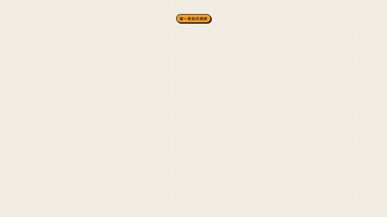
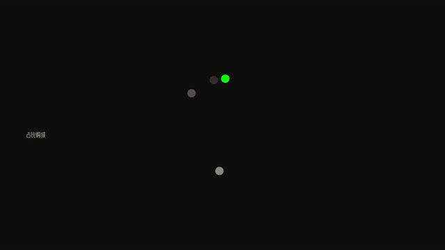
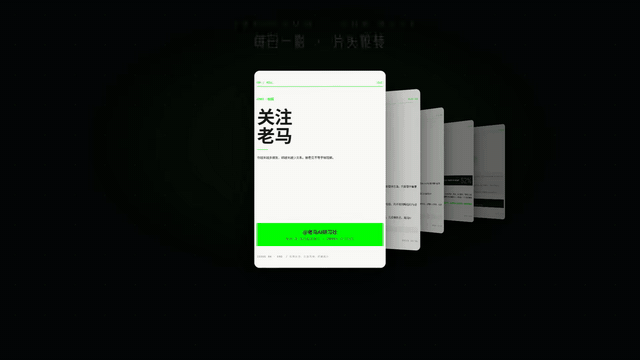
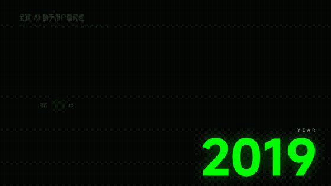
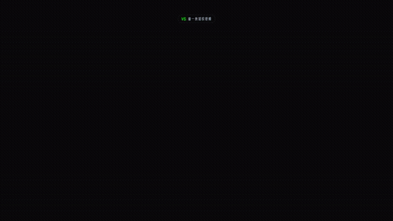

# Motion Prompts · 视频动效模板与提示词（1047 个模板 + 600 个提示词 · 全部免费获取）

[](https://maning789link.top/station.html)
[](#本仓有什么)
[](#本仓有什么)
[](LICENSE)

[](https://maning789link.top/station.html)

> 上图：编辑器试玩器（测试区）——挑底片、叠动效、拖位置、画轨迹，compose.json 一键导入/导出，浏览器里完成编排。

**🎬 在线预览全部动效 → https://maning789link.top/station.html**

本仓提供三样东西，全部免费获取、全部可直接使用：

- **1047 个动效模板** —— 可运行的 HTML 页面，浏览器打开即播放；
- **600 个提示词** —— 喂给任意 AI，AI 照样给你生成一个动效页面；
- **精选样片** —— 每个模板族挑代表作，README 里直接看。

## 快速开始

**方式一：直接用模板（最快）**

1. 从 [SAMPLES.md](SAMPLES.md) 挑一个模板；
2. 打开 `templates/<模板名>/index.html`，浏览器打开即播放；
3. 文案、数字、颜色都集中在文件顶部的 JS 常量里，随改随用。

**方式二：用提示词让 AI 生成（可定制）**

1. 先去[预览站](https://maning789link.top/station.html)看动效长什么样；
2. 从 [SAMPLES.md](SAMPLES.md) 挑一个，复制 `.md` 文件里分隔线以下的整段提示词；
3. 粘贴发给你的 AI（Claude Code / Codex / 豆包 / DeepSeek……），不需要任何额外解释；
4. AI 输出 HTML 存成文件，浏览器打开播放，录屏即成片。

生成的页面是 1920×1080 横屏（可嵌入组件为 480×270），文案、数字、颜色都集中在文件顶部的 JS 常量里。

**不需要 Claude 和 Codex。豆包、DeepSeek 也能一键出片。**

## 效果预览

GIF 有压缩，预览站里是 1080p 原片：

| 终端打字演示（奶油版） | 前后数据对比（奶油版） |
|:---:|:---:|
|  |  |
| **大数字卡** | **环形占比图** |
|  |  |
| **封面流转播** | **档案照片放大聚焦** |
|  |  |

### 精选样片

七大类各挑代表，共 42 条GIF，按形态分层挑选（积木风 / 积木暴力 / 奶油贴纸 / 数据图表 /
贴纸叠加 / 转场 / 音频频谱 / 视觉动效…），完整清单见 [assets/samples/index.md](assets/samples/index.md)。

| 概念解释（知识口播） | 数据汇报 |
|:---:|:---:|
|  |  |
| **数据对比（知识口播）** | **勾选清单（企业宣传）** |
|  |  |
| **钩子卡（短视频引流）** | **转场（转场与镜头）** |
|  |  |
| **划线价对撞（电商带货）** | **贴纸气泡（直播贴片）** |
|  |  |

> 在线可看全部 1047 条样片 → https://maning789link.top/station.html

## 模板怎么用

### 目录结构

```
templates/<模板名>/index.html     # 完整动效模板（1920×1080）
components/<模板名>.html          # 可嵌入组件（480×270 透明底，可直接压在视频上）
prompts/<编号>-<名称>.md          # 提示词（喂给 AI 用）
templates/_lib/                   # 共享库（GSAP / 积木块 / 贴纸形态等）
```

### 两种模板的区别

| | `templates/` | `components/` |
|---|---|---|
| 画布 | 1920×1080 横屏 | 480×270 小画布 |
| 背景 | 自带完整背景 | 透明底，可直接叠在视频/图片上 |
| 适合 | 成片镜头、章节页、数据页 | 贴纸、角标、字幕条、贴片 |

组件是**透明底**的：把它压在你的实拍视频上，就能得到「画面里长出一块动效」的效果。

### 可填参数

模板顶部有一段 JS 常量区，可以直接改：

```js
const V = {
  title: "标题文案",
  value: "88",
  note: "补充说明"
};
```

改完刷新浏览器即可。有些模板还支持 URL 参数覆盖，方便在网页里动态驱动。

### 依赖说明

模板依赖 `templates/_lib/` 下的共享库（GSAP 动画引擎、积木块、贴纸形态库等），
**请保持目录结构不变**，双击 `index.html` 即可运行。

字体不随本仓分发（受字体厂商许可限制），模板已改用系统字体回退栈，
在 Windows / macOS 上都能正常显示。

## 配套 Skill：把「几百个零件」变成「一条流水线」

单独复制一个模板或提示词，你能得到一个动效——这很好，但**这只是零件**。
真正做内容的人缺的不是零件，是**流水线**：

- 写完一篇文章，还要人肉拆点、逐个选模板、逐条改文案、逐个录屏、进剪辑软件拼接——
  一条 60 秒的片子，动效能吃掉一下午；
- 想保持风格统一？每个镜头的配色、字体、节奏都得人肉对齐；
- 画面和口播对轨，又是一场手工拉锯。

**装上配套生产 Skill，这一切交给 AI**：把文章丢给它，它自动
**拆文案 → 选模板 → 渲单镜 → 合成底片 → 输出 compose.json**——交付物永远是两个文件：
`base.mp4`（底片）+ `compose.json`（动效编排清单）。之后三种加工方式任选：

1. **自合成**：本地按 compose.json 逐层渲染出片；
2. **测试区自助**：把两个文件传上[编辑器试玩器](https://maning789link.top/station.html)——
   拖位置、调大小、画轨迹、播预览，调完导出新 JSON 再合成。Agent 改十遍不如这里拖一遍，省 token；
3. **平台代加工**：需要的话把文件交给我们出片。

compose.json 是**开放规范**（compose/2）——把同一份 JSON 递回给你自己的 Agent，
照着规范就能做出你自己的 Skill，往后自我更新，不用依赖任何人。

## 本地渲染（可选）

模板和提示词生成的 HTML 用浏览器录屏就能用；要直接出 MP4，可用 hyperframes 渲染器。
我们备好了**免 npm 的离线环境包**（内置浏览器，解压即用，全程不联网），
领取方式见预览站首页说明。

## 本仓有什么

- `templates/` —— **1047 个动效模板**，全部免费获取，开箱即用：
  - 知识口播 346 个：概念解释、流程拆解、清单核对、认知偏差科普；
  - 短视频引流 291 个：钩子卡片、评论区引导、混剪片尾；
  - 企业宣传 107 个：品牌信息块、数据陈述、价值主张；
  - 数据汇报 106 个：单数据大字卡、华夫图、进度环；
  - 直播贴片 103 个：表情气泡、手势、粒子特效、贴纸；
  - 电商带货 66 个：划线价对撞、第二件半价、订阅清单；
  - 转场与镜头 28 个：信箱收放、雨滴扩散、故障切。
- `components/` —— **97 个可嵌入组件**，480×270 透明底，可直接压在实拍画面上。
- `prompts/` —— **600 个提示词**，全部免费获取，喂给任意 AI 即可生成同类动效。
- `SAMPLES.md` —— 总目录（编号 / 名称 / 分类 / 时长 / 文件位置）。
- `assets/` —— 效果预览 GIF；`assets/samples/` 是 42 条精选样片（清单见 [index.md](assets/samples/index.md)）。

## 许可（摘要，以 LICENSE 全文为准）

- ✅ 模板与提示词可自由使用，**生成的视频可商用**（接单、广告、发平台都行）；
- ❌ 禁止将模板与提示词本身打包转售，或搬运到其他提示词站/付费社群再分发；
- ❌ 禁止删除文件中的溯源标识、禁止冒用「老马AI研习社」名义；
- ℹ️ 模板依赖的 GSAP、hyperframes 均为第三方组件，受各自许可约束；
  字体（MiSans / 美呗嘿嘿体）文件不随本仓分发，模板已改用系统字体回退。

第三方组件的授权说明见 [NOTICE.md](NOTICE.md)。

## 想要完整内容？

本仓给的是模板和提示词本身。想要**完整的素材库 + 在线挑选 + 直接下载**，
去预览站：https://maning789link.top/station.html

更多内容可以关注公众号「老马AI研习社」，或者加我个人微信（公众号后台回复「微信」领取）。

觉得有用就 Star 一下，预览站会持续上新。
