# 精选样片

每个大类挑 6 条代表作（按版式分层挑选，保证形态多样）。

## 知识口播（6 条）

### API 调用

文件：[templates/api-call-mock/index.html](../../templates/api-call-mock/index.html) ｜ 分类：封面与卡片 ｜ 版式：concept

### 前后对比数字

文件：[templates/before-after-stat/index.html](../../templates/before-after-stat/index.html) ｜ 分类：数据与图表 ｜ 版式：compare

### 卡片宫格 · 把 AI 塞进日常的六个位置

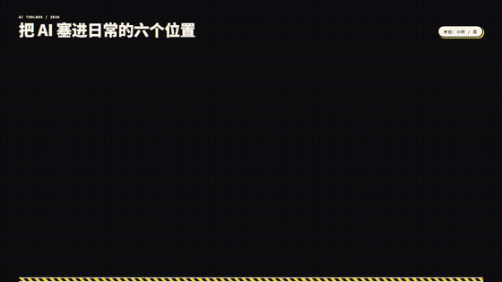

文件：[templates/blk-grid-ai-toolbox/index.html](../../templates/blk-grid-ai-toolbox/index.html) ｜ 分类：封面与卡片 ｜ 版式：card

### 标题换词

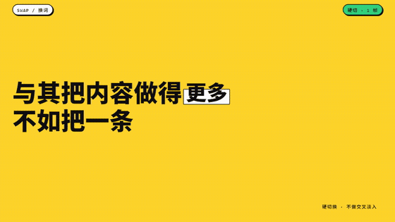

文件：[templates/blk-brut-kb-08/index.html](../../templates/blk-brut-kb-08/index.html) ｜ 分类：文字与收尾 ｜ 版式：card

### 便签流程链（白板手账）

文件：[templates/board-flow-arrows/index.html](../../templates/board-flow-arrows/index.html) ｜ 分类：图解与流程 ｜ 版式：card

### 四栏能力拼装

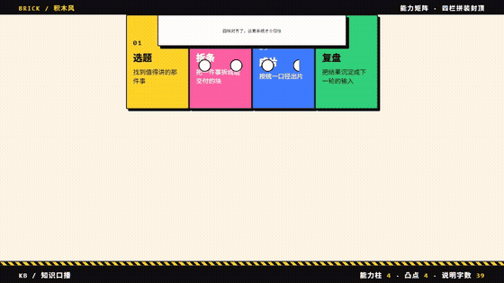

文件：[templates/brik-kb-10/index.html](../../templates/brik-kb-10/index.html) ｜ 分类：图解与流程 ｜ 版式：card

## 数据汇报（6 条）

### 面积图

文件：[templates/area-chart/index.html](../../templates/area-chart/index.html) ｜ 分类：数据与图表 ｜ 版式：data

### 排名竞速条形图（模式特效）

文件：[templates/bar-chart-race-smooth/index.html](../../templates/bar-chart-race-smooth/index.html) ｜ 分类：数据与图表 ｜ 版式：card

### 积木大数 · 项目战绩

文件：[templates/blk-punch-counter/index.html](../../templates/blk-punch-counter/index.html) ｜ 分类：数据与图表 ｜ 版式：blk-counter

### Checklist 打勾卡

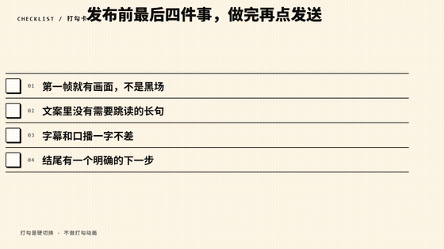

文件：[templates/blk-brut-dq-12/index.html](../../templates/blk-brut-dq-12/index.html) ｜ 分类：数据与图表 ｜ 版式：card

### 同比三段递进

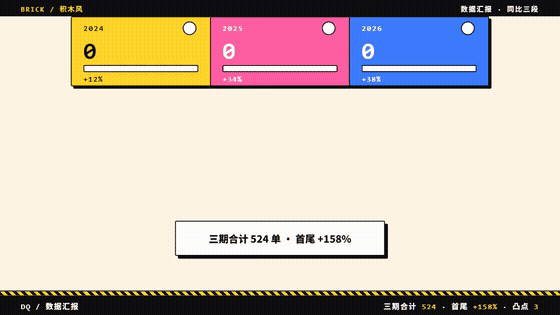

文件：[templates/brik-dq-05/index.html](../../templates/brik-dq-05/index.html) ｜ 分类：信息卡片 ｜ 版式：card

### 数据来源引用卡（奶油贴纸）

文件：[templates/cream-source-citation-card/index.html](../../templates/cream-source-citation-card/index.html) ｜ 分类：数据与图表 ｜ 版式：data

## 短视频引流（6 条）

### 卡点条 · 切点直读

文件：[components/beat-beat-cut-bar.html](../../components/beat-beat-cut-bar.html) ｜ 分类：叠加组件 ｜ 版式：—

### 分栏数字条 · 哪一步真的拉来了人

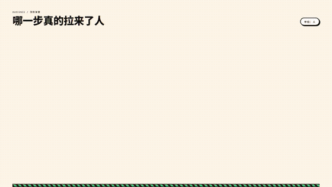

文件：[templates/blk-cols-reader-growth/index.html](../../templates/blk-cols-reader-growth/index.html) ｜ 分类：封面与卡片 ｜ 版式：card

### 误区抽换反转钩子

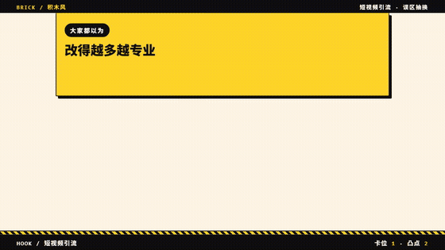

文件：[templates/brik-hook-02/index.html](../../templates/brik-hook-02/index.html) ｜ 分类：封面与卡片 ｜ 版式：hook

### 引用块（奶油贴纸）

文件：[templates/cream-pull-quote-hero/index.html](../../templates/cream-pull-quote-hero/index.html) ｜ 分类：封面与卡片 ｜ 版式：close

### 节拍环 · 每一拍走一格

文件：[templates/beatfull-ring/index.html](../../templates/beatfull-ring/index.html) ｜ 分类：数据与图表 ｜ 版式：card

### 遮罩转场 · 四种画框形状

文件：[templates/mix-mask/index.html](../../templates/mix-mask/index.html) ｜ 分类：镜头与转场 ｜ 版式：turn

## 转场与镜头（6 条）

### 滑动变焦·字隧道

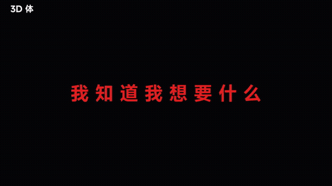

文件：[templates/atom-kinetic-01/index.html](../../templates/atom-kinetic-01/index.html) ｜ 分类：镜头与转场 ｜ 版式：turn

### 积木拆散露题

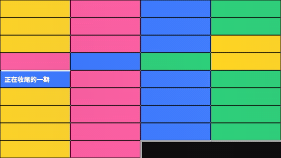

文件：[templates/brik-wall-02/index.html](../../templates/brik-wall-02/index.html) ｜ 分类：镜头与转场 ｜ 版式：turn

### 线条横扫转场

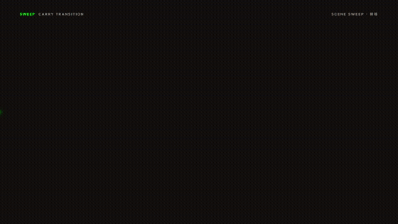

文件：[templates/line-carry-transition/index.html](../../templates/line-carry-transition/index.html) ｜ 分类：镜头与转场 ｜ 版式：card

### 模糊切入

文件：[templates/softmelt-dissolve/index.html](../../templates/softmelt-dissolve/index.html) ｜ 分类：镜头与转场 ｜ 版式：—

### 马赛克格重构

文件：[templates/sc2-tessell-01/index.html](../../templates/sc2-tessell-01/index.html) ｜ 分类：镜头与转场 ｜ 版式：card

### 纵向擦拭·上→下

文件：[templates/transition-wipe-down/index.html](../../templates/transition-wipe-down/index.html) ｜ 分类：镜头与转场 ｜ 版式：—

## 电商带货（6 条）

### 叠压卡片 · 出门干活带这几样就够

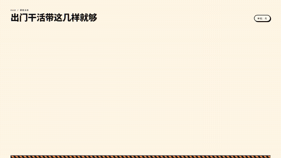

文件：[templates/blk-stack-gear-kit/index.html](../../templates/blk-stack-gear-kit/index.html) ｜ 分类：图解与流程 ｜ 版式：card

### 满减券卡

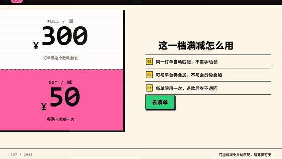

文件：[templates/blk-brut-ec-07/index.html](../../templates/blk-brut-ec-07/index.html) ｜ 分类：封面与卡片 ｜ 版式：card

### 四格规格凸点阵

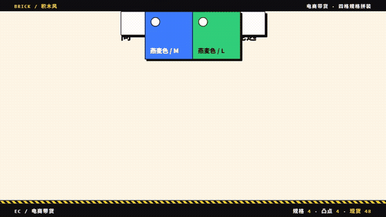

文件：[templates/brik-ec-04/index.html](../../templates/brik-ec-04/index.html) ｜ 分类：信息卡片 ｜ 版式：card

### 聊天打赏转账

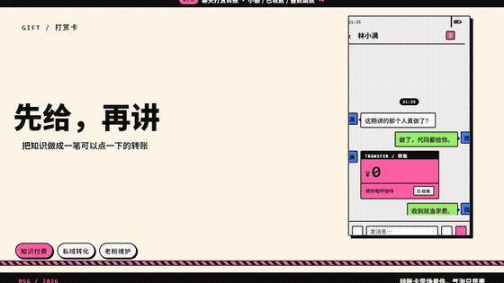

文件：[templates/msg-transfer-02/index.html](../../templates/msg-transfer-02/index.html) ｜ 分类：信息卡片 ｜ 版式：card

### 带货收尾·斜切价签

文件：[templates/outro-shop-slash/index.html](../../templates/outro-shop-slash/index.html) ｜ 分类：文字与收尾 ｜ 版式：close

### 卖点竖排对位

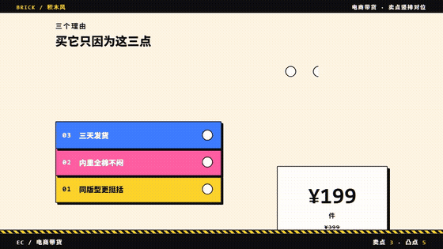

文件：[templates/brik-ec-07/index.html](../../templates/brik-ec-07/index.html) ｜ 分类：信息卡片 ｜ 版式：card

## 企业宣传（6 条）

### 排序条形榜 · 把一周切成格子再塞进去

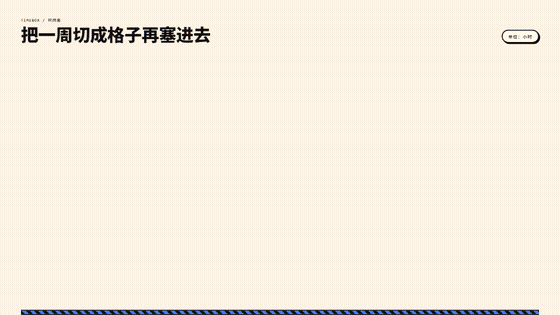

文件：[templates/blk-bars-team-time/index.html](../../templates/blk-bars-team-time/index.html) ｜ 分类：数据与图表 ｜ 版式：card

### 改造前后双栏对撞

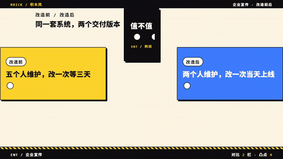

文件：[templates/brik-ent-10/index.html](../../templates/brik-ent-10/index.html) ｜ 分类：封面与卡片 ｜ 版式：card

### 纪录片 B19 档案卷宗

文件：[templates/docu-form-archive/index.html](../../templates/docu-form-archive/index.html) ｜ 分类：文字与收尾 ｜ 版式：—

### 点赞关注 CTA

文件：[templates/follow-cta/index.html](../../templates/follow-cta/index.html) ｜ 分类：文字与收尾 ｜ 版式：brand

### 红头通知单（公文表单）

文件：[templates/form-red-notice/index.html](../../templates/form-red-notice/index.html) ｜ 分类：文字与收尾 ｜ 版式：card

### 宣传收尾·口号分栏

文件：[templates/outro-brand-split/index.html](../../templates/outro-brand-split/index.html) ｜ 分类：文字与收尾 ｜ 版式：close

## 直播贴片（6 条）

### 章节跳转表（透明叠加）

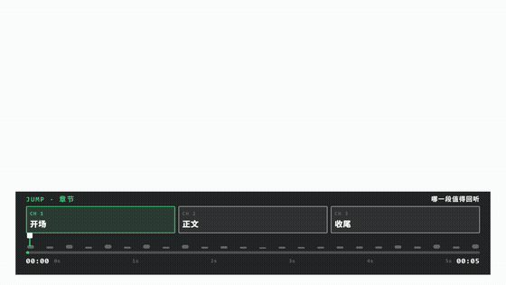

文件：[templates/aud-progress-02/index.html](../../templates/aud-progress-02/index.html) ｜ 分类：叠加组件 ｜ 版式：overlay

### 地点条

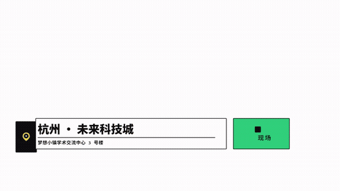

文件：[templates/blk-brut-lt-17/index.html](../../templates/blk-brut-lt-17/index.html) ｜ 分类：叠加组件 ｜ 版式：overlay

### 角标块砸落

文件：[templates/brik-lt-01/index.html](../../templates/brik-lt-01/index.html) ｜ 分类：叠加组件 ｜ 版式：overlay

### 界面动效·控件状态机

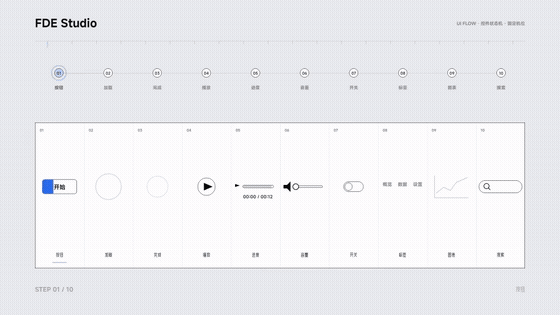

文件：[templates/ui-flow-01/index.html](../../templates/ui-flow-01/index.html) ｜ 分类：叠加组件 ｜ 版式：overlay

### 哈士奇弹入

文件：[components/pop-char-pop-in.html](../../components/pop-char-pop-in.html) ｜ 分类：叠加组件 ｜ 版式：—

### 底部横条推入

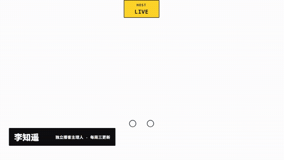

文件：[templates/brik-lt-02/index.html](../../templates/brik-lt-02/index.html) ｜ 分类：叠加组件 ｜ 版式：overlay
